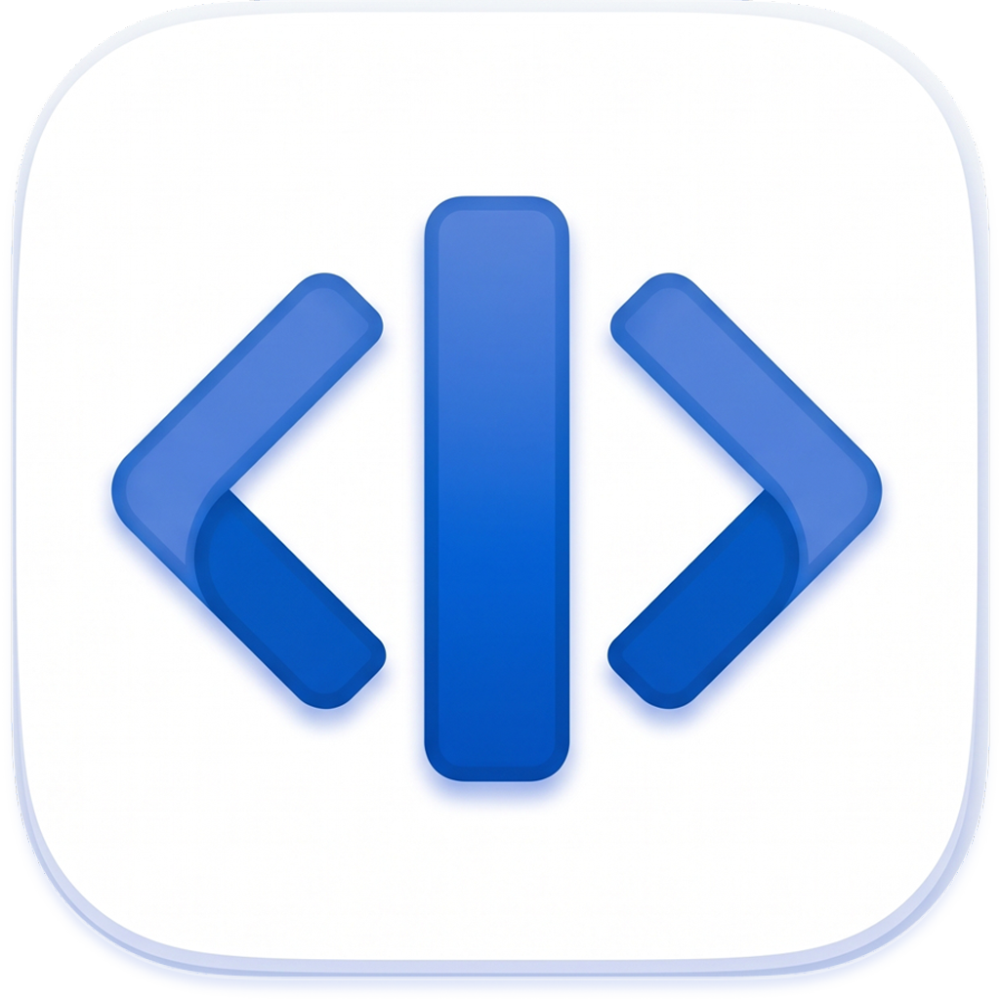
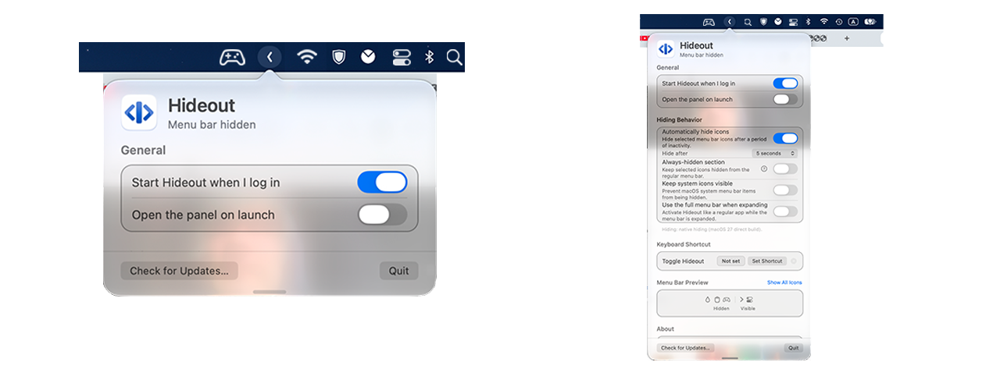
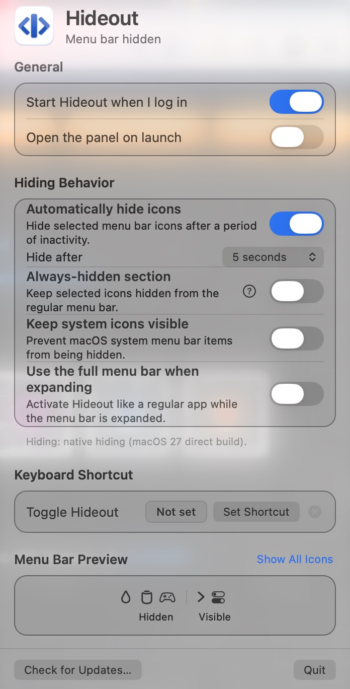

<p align="center">
	
</p>
<p align="center">
<a href="https://github.com/xvoland/hidden/releases/latest">
		
  </a>
</p>

## HIDEOUT — The World’s Smallest Menu Bar Hiding App

Hideout is a lightweight macOS utility that lets you hide unwanted menu bar icons and keep your Mac interface clean and organized.

It is designed for people who have too many background apps, system utilities, and status icons competing for space in the macOS menu bar.

<p align="center">
<a href="https://dotoca.net/hideout">
 		
  </a>
</p>


## ✦ Small App. Big Cleanup.

- Hide the clutter — Keep your menu bar clean and organized.
- See what matters — Leave your essential icons visible.
- Reveal when needed — Access hidden icons whenever you want.
- Stay lightweight — A simple, unobtrusive macOS utility.
- Feel at home — Built around familiar macOS interactions.


Includes compatibility work for macOS 27 "Golden Gate" and **wide screens like QHD, UltraWide QHD, 4K UHD, Super UltraWide, 5K2K/WUQHD**, etc.

<p align="center">
	
</p>


<p align="center">
	
</p>


## 🚀 Install

These builds are **ad-hoc / unsigned** (`CODE_SIGNING_ALLOWED=NO`) — no Developer ID
signature, no notarization. (Support the project to purchase a signature from Apple.)

macOS ties the Accessibility permission to the code
signature, so after **every update** re-grant it in System Settings when prompted
(first collapse asks again); that is expected, not a bug.


#### Using Homebrew

This fork ships its own Homebrew cask so you install **this** build — not the
upstream one:

```
brew install --cask https://raw.githubusercontent.com/xvoland/hideout/master/Casks/hideout.rb
```


### Security & Manual download

Hideout is an independent, open-source project, and unfortunately, we don’t have the budget for an Apple Developer Program membership yet. This means the app isn’t signed and notarized by Apple.

The first time you open Hideout, macOS may show a security warning. To open the app, you’ll need to follow these steps:

1. Download Hideout from the [latest release](https://github.com/xvoland/hideout/releases)
2. Move the app to your **Applications folder.**
3. If macOS blocks it, **open System Settings → Privacy & Security**, find the message about Hideout, and **click Open Anyway**. You may need to try opening the app first.
4. Confirm that you want to open it.

We know this isn’t as convenient as installing a notarized app, and we’re sorry for the extra steps. If you find Hideout useful and would like to help us cover the cost of an Apple Developer membership, your support would mean a lot. 

❤️ Thank you for supporting independent, open-source software!

The build is **unsigned**, so before the first launch run:

```
xattr -dr com.apple.quarantine /Applications/Hideout.app
```

<p align="center">
	
</p>


## ⚙️ Hiding (macOS 27)

macOS 27 Golden Gate rebuilt the menu bar as a single window. Hiding is always native since v1.19: Hideout asks macOS's private `MenuBarClientCore` (assessment mode) to keep only an allow-list visible. macOS does the hiding/reflow itself — independent of display width, notch, or front app.

Requirements: the **direct (non-sandboxed) build** on **macOS 27** (this GitHub/ad-hoc release, compiled with `HIDDENBAR_NATIVE_VISIBILITY=1`), plus **Accessibility** permission (prompted on first collapse). Where unavailable (sandboxed builds, pre-27), collapsing reports unavailable and the arrow stays put.


## 🕹 Usage

* `⌘` + drag icons across the `|` separator: left of it hides on collapse.
  A second, translucent `|` (enable *Always hidden section* in the tray
  panel — right-click the arrow) marks a zone that stays hidden even when expanded.
* Click the Arrow icon to hide menu bar items.
* **Option-click** the arrow or a separator to show/hide separators for
  arranging (reveals everything for `⌘`-dragging). If Option-click does
  nothing on your setup, use the tray panel → **Show All Icons**.
* Missing an icon after quit/update? Check the system `«` overflow first —
  macOS parks displaced icons there and doesn't always re-seat them.

<p align="center">
	
</p>

<p align="center">
	
</p>


## 📚 Documentation

- [Manual](docs/MANUAL.md): every setting, the hidden Terminal-only options, and troubleshooting.
- [Architecture](docs/ARCHITECTURE.md): how the hiding trick works, topology, and known limits.
- [Maintainer runbook](docs/RUNBOOK.md): build, behavioral verification, and release process.

## Requirements
macOS version >= 13.0 (Ventura)

Running an older macOS? The last release supporting macOS 10.13 High Sierra
through 12 Monterey is [upstream v1.10](https://github.com/dwarvesf/hidden/releases/tag/v1.10)
(published by the original Dwarves Foundation project; this fork does not ship
pre-Ventura builds). Later versions require macOS 13 because autostart moved to the
`SMAppService` API introduced there.

## You may also like
- [Blurred](https://github.com/dwarvesf/Blurred) - A macOS utility that helps reduce distraction by dimming your inactive noise
- [Micro Sniff](https://github.com/dwarvesf/micro-sniff) - An ultra-light macOS utility that notify whenever your micro-device is being used
- [VimMotion](https://github.com/dwarvesf/VimMotionPublic) Vim style shortcut for MacOS

## License

&copy; 2026, Vitalii Tereshchuk / xVoLAnD ([https://dotoca.net/hideout](https://dotoca.net/hideout)). All rights reserved.

MIT &copy; [Dwarves Foundation](https://github.com/dwarvesf)

Upstream project: [dwarvesf/hidden](https://github.com/dwarvesf/hidden)

**Tiny app. Tidy Mac.** ❤️

